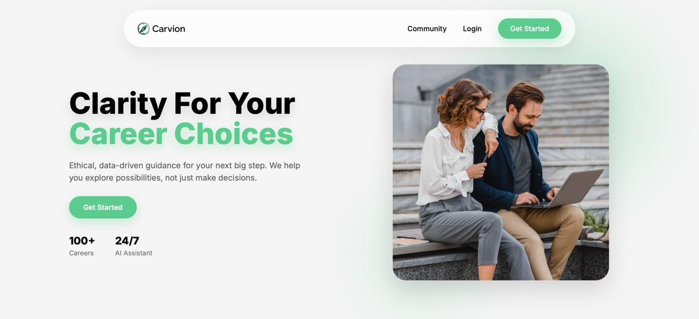
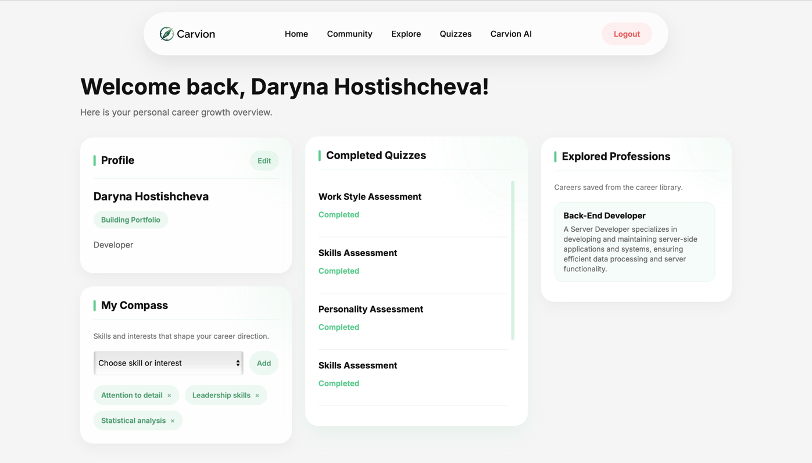
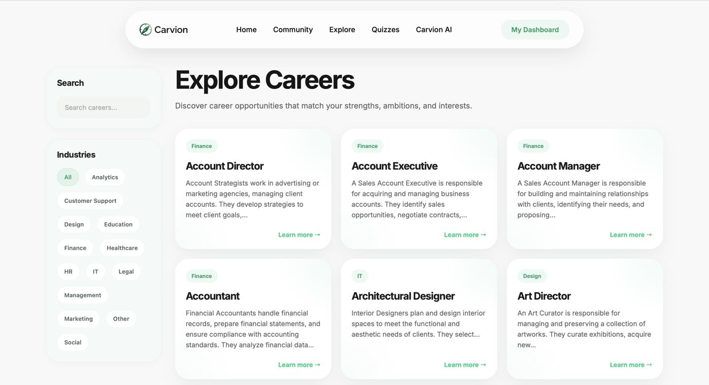
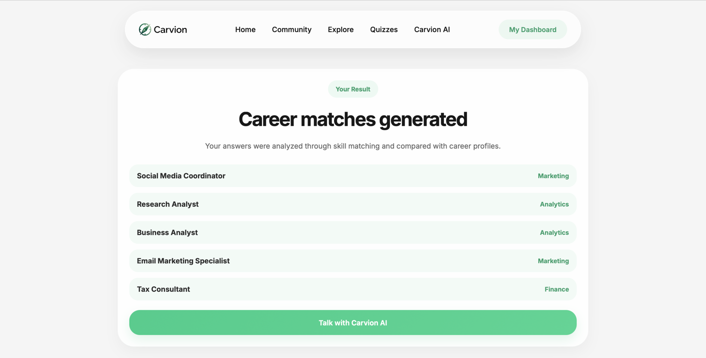
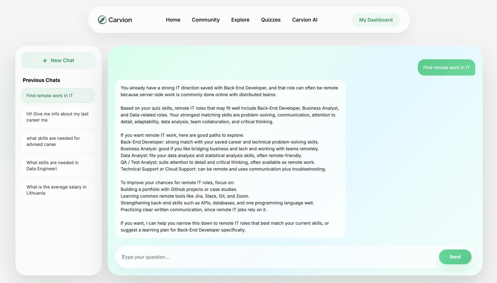
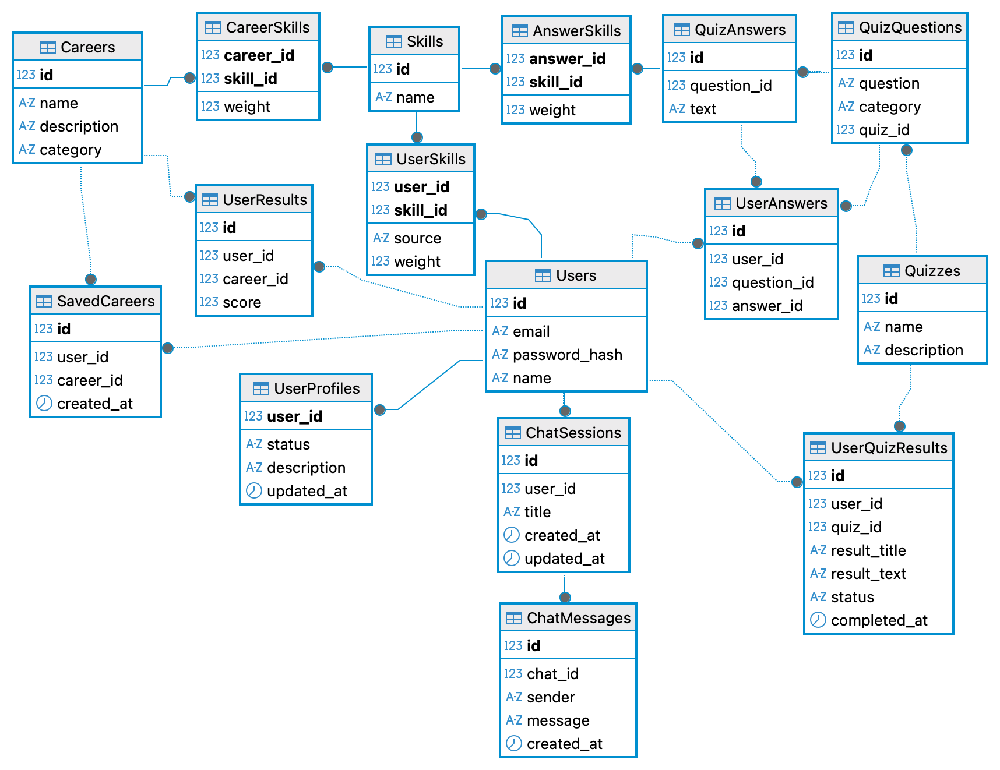

# Carvion

A career guidance website developed as a bachelor thesis project at Vytautas Magnus University (Informatics Systems, 2026).

Demo: https://darynahostishcheva.github.io/carvion-project/

## About

Carvion is designed to help users explore career options. Short quizzes, a library of 100 careers, personalised career recommendations and an AI assistant are combined in one free website.

The project was based on an analysis of existing career platforms (Mindler, CareerExplorer, Truity). Most of them were found to be partly paid or to give only a static test result without further explanation. The AI assistant in Carvion is intended to support the user in exploring options, not to make the final career choice for them.

## Functionality

### Accounts
- Users can register and log in with an email and password.
- Passwords are stored as hashes (bcrypt), and a JWT token is issued after login.
- Protected pages are available only to logged-in users; other users are redirected to the login page.
- The navigation is changed depending on whether the user is logged in.

### Dashboard
- The user's profile is shown: name, career status and a short description. All of them can be edited.
- Skills and interests ("My Compass") can be added from the skills list or removed. Skills identified from quiz answers are also added here automatically.
- Completed quizzes and saved careers are displayed.

### Career library
- 100 careers are available, grouped into categories (IT, Finance, Marketing, Design, Healthcare and others).
- Careers can be searched by name, description or category, and filtered by category.
- A separate page is provided for each career, with a full description and the list of required skills.
- Careers can be saved and unsaved. Saved careers are shown on the dashboard.

### Quizzes
- Three quizzes are included: Work Style, Skills and Personality.
- Each quiz consists of 8 questions with Low, Medium and High answer options.
- The answers are stored, and the quiz result is saved to the user's history.

### Career recommendations
- After a quiz is submitted, the top 5 matching careers are calculated and shown to the user.
- The recommendations are saved and replaced with new ones after the next quiz.
- From the results page, the user can go directly to the AI assistant.

### AI assistant (Carvion AI)
- Career-related questions can be asked in a chat.
- Each question is sent to the OpenAI API together with the user's context from the database: saved careers, latest recommendations, recent quiz results and top skills.
- Chats are saved. A new chat can be started, and previous chats can be reopened from the side panel.
- The assistant is instructed to explain options and not to make decisions for the user.

### Community
- A community page with links to Instagram, Facebook and email is included.

### Responsive design
- The interface is adapted for desktop and mobile devices.

| Dashboard | Career library |
|---|---|
|  |  |

| Quiz results | AI assistant |
|---|---|
|  |  |

## How recommendations are calculated

Each quiz answer is linked to one or more skills with a weight. When a quiz is submitted, the weights of the selected answers are summed into a skill vector for the user. Each career is also represented as a vector of weighted skills. The user vector is compared with every career vector using cosine similarity, and the five careers with the highest score are returned as recommendations.

This approach was chosen instead of a machine learning model because every result can be explained: it can always be traced back to the answers given and the skill weights behind them.

## Tech stack

- Frontend: HTML, CSS, JavaScript
- Backend: Node.js, Express
- Database: MySQL (hosted on Aiven), designed in DBeaver
- Authentication: JWT, bcrypt
- AI: OpenAI API
- Hosting: GitHub Pages (frontend), Render (backend)

## Database

More diagrams: [data flow](docs/images/data-flow.png), [use case](docs/images/use-case.png).

## Data

The career data was taken from the [Kaggle Job Description Dataset](https://www.kaggle.com/datasets/ravindrasinghrana/job-description-dataset). The dataset was cleaned with a Node.js script: 100 unique job titles were selected, categories were assigned by keywords, skills were extracted, and SQL insert statements were generated for the database. As a result, 100 careers and 458 skills were imported.

## Author

Daryna Hostishcheva · [LinkedIn](https://www.linkedin.com/in/daryna-hostishcheva-63b6a42b3/)
